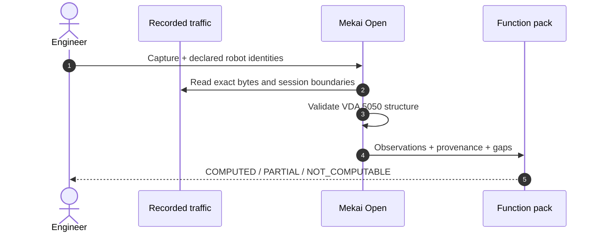
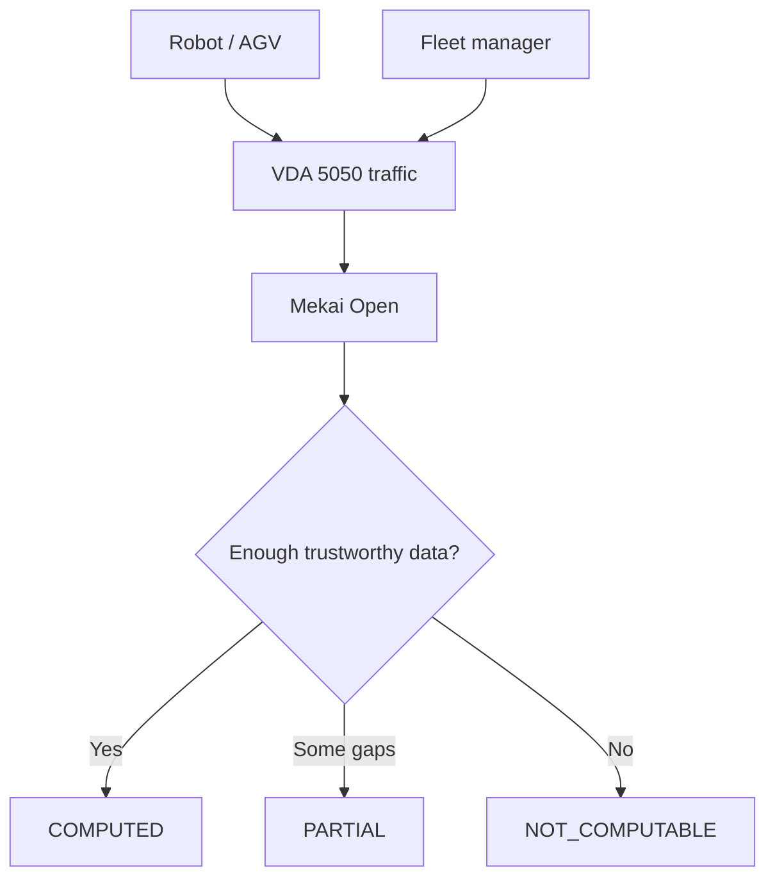

<div align="center">

# Mekai Open

### Know what your mobile robots actually did.

Vendor-neutral, read-only analysis for recorded **VDA 5050 3.0.0** traffic — with exact provenance, explicit missingness, and no invented certainty.

[](https://github.com/kaustubhkr/mekai-open/actions/workflows/ci.yml)
[](https://www.python.org/)
[](https://github.com/VDA5050/VDA5050)
[](LICENSE)

**Developer preview · synthetic/lab-qualified · not production-qualified**

</div>

---

<table>
<tr>
<td width="33%"><strong>✓ Available now</strong><br/>Recorded capture analysis core</td>
<td width="33%"><strong>◌ Next</strong><br/>MQTT + ROS 2 adapters</td>
<td width="33%"><strong>◇ Private preview</strong><br/>Encrypted runs + Mekai Lab</td>
</tr>
</table>

## What is available

```mermaid
flowchart LR
    A["Capture JSONL"] --> B["Strict input boundary"]
    B --> C["VDA 5050 3.0 validation"]
    C --> D["Normalized observations"]
    D --> E["13 versioned functions"]
    E --> F["Coverage + diagnostics"]
    F --> G["Deterministic run model"]

    classDef input fill:#eef2ff,stroke:#4f46e5,color:#111827;
    classDef core fill:#ecfeff,stroke:#0891b2,color:#111827;
    classDef result fill:#f0fdf4,stroke:#16a34a,color:#111827;
    class A input;
    class B,C,D,E core;
    class F,G result;
```



Mekai Open accepts an explicit robot identity and a recorded capture. It preserves the exact payload bytes, validates supported message families, tracks collector sessions and discontinuities, and executes every registered function in one normalized pass.



### Current capability boundary

| Capability | Status | What it means |
|---|---|---|
| Strict Capture JSONL ingestion | **Available** | Bounded streaming parser, exact payload bytes, drops and session boundaries |
| VDA 5050 3.0.0 structural validation | **Available** | `connection`, `state`, `order`, and `instantActions` |
| Recorded analysis core | **Available** | 13 registered executors, deterministic in-memory run document |
| Source quality and provenance | **Available** | Coverage, gaps, missingness, clock/header diagnostics, input fingerprint |
| Live MQTT capture | **In progress** | Subscribe-only adapter; no robot or fleet commands |
| ROS 2 bag ingestion | **In progress** | Jazzy SQLite3 and MCAP adapters |
| Encrypted `.mekai-run` | **Private preview** | Portable result bundle; not included in this release |
| `open.mekailabs.com` | **Private preview** | Optional hosted viewer; not required by the open analysis core |

## The first function pack

| Source & availability | Robot state | Orders & incidents |
|---|---|---|
| State-stream health | Connection-state duration | Observed orders |
| Drops, gaps and sessions | Driving duration | Inferred error episodes |
| Clock and header diagnostics | Operating-mode duration | Inferred protocol outcomes |
| Coverage and missingness | Paused duration | Inferred execution duration |
|  | Charging duration | Finished orders / observed robot-hour |
|  | Battery state-of-charge |  |
|  | Reported safety-state duration |  |

Every result is versioned and carries its basis: **REPORTED** or **INFERRED**. Missing data is part of the result, not silently filled in.

## Try the implemented CLI

Requires Python 3.12.

```bash
git clone https://github.com/kaustubhkr/mekai-open.git
cd mekai-open
python3.12 -m venv .venv
source .venv/bin/activate
python -m pip install --require-hashes -r requirements-runtime.txt
python -m pip install --no-deps -e .
mekai-open specs list
mekai-open specs describe vda.state_stream_health@0.1.0
```

The public CLI currently exposes the function catalogue. The recorded analysis engine is implemented and tested as a package-internal boundary; a stable end-user `analyze` command is the next public surface.

## Why this exists

Robot deployments cross boundaries: robot, fleet manager, broker, WCS/WES, doors, conveyors, lifts, chargers and PLCs. The first problem is not another dashboard. It is knowing which conclusions the available data can support — and which it cannot.



## Safety and claim boundary

- Read-only analysis: this project does not command robots or site equipment.
- Structural schema validity is not behavioral conformance or certification.
- Reported safety fields are descriptive telemetry, not a safety finding.
- Inferred order outcomes are protocol observations, not business truth.
- Current qualification uses synthetic fixtures; cross-vendor and production qualification are not claimed.

## What comes next

1. Subscribe-only live MQTT collection.
2. ROS 2 Jazzy bag ingestion for SQLite3 and MCAP.
3. Encrypted portable run bundles and optional Mekai Lab viewing.
4. Live observability across robots and site systems.
5. Alarm definition, evaluation, suppression and routing.
6. Incident replay and robot-to-site interface verification.
7. Sandboxed custom function creation.

Fleet-management-system functionality is being evaluated later; it is not part of the current roadmap.

## Contributing and security

Read [CONTRIBUTING.md](CONTRIBUTING.md) before opening a pull request. Report security issues privately using [SECURITY.md](SECURITY.md).

## License

Copyright © 2026 Kaustubh Krishna and Mekai Open contributors.

Licensed under **AGPL-3.0-only**. See [LICENSE](LICENSE) and [THIRD_PARTY_NOTICES.md](THIRD_PARTY_NOTICES.md).
