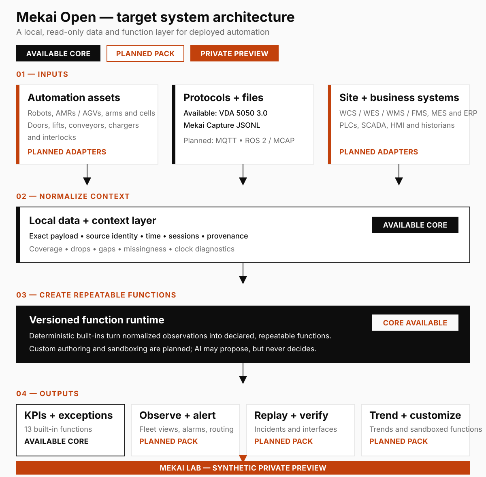
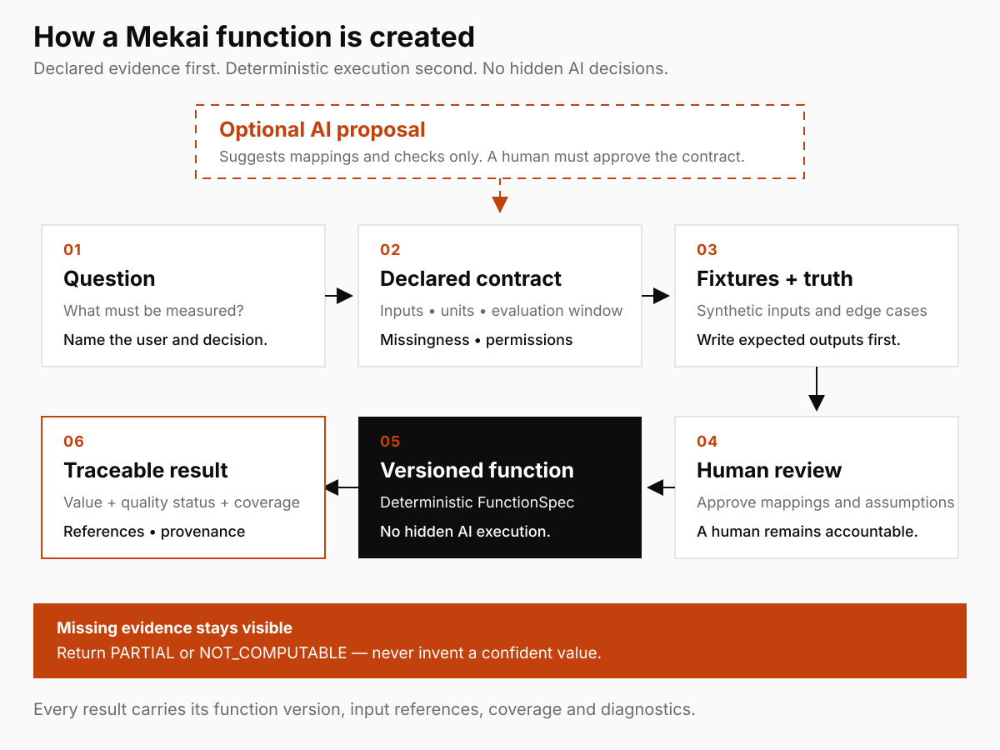

<div align="center">

<a href="https://mekailabs.com"></a>

# Mekai Open

### Open data and function infrastructure for physical automation.

Connect robot, automation, and business-system data. Build versioned operational functions. Return every answer with its coverage, quality, missingness, and provenance.

[Website](https://mekailabs.com) · [Live Lab](https://open.mekailabs.com) · [Security](SECURITY.md) · [Contribute](CONTRIBUTING.md)

[](https://github.com/Mekai-Labs/mekai-open/actions/workflows/ci.yml)
[](https://www.python.org/)
[](https://github.com/VDA5050/VDA5050)
[](LICENSE)

**Local-first · read-only · vendor-neutral by design · nothing sent by default**

</div>

<br>

<div align="center">
  <a href="https://open.mekailabs.com">
    
  </a>
  <p><sub>Live Mekai Lab flow · synthetic demonstration data · click to open the protected preview</sub></p>
</div>

## One layer. Many automation functions.

| Connect | Create | Trust |
|---|---|---|
| Consume data from robots, controllers, site equipment, files, brokers, and business systems. | Turn operational questions into reviewed, versioned functions instead of one-off dashboards and scripts. | Keep source identity, exact payload references, coverage, gaps, assumptions, and result basis attached to every answer. |

Mekai Open is not a fleet manager, WCS, PLC programmer, safety controller, or another opaque dashboard. It is the open calculation foundation that sits above existing systems and makes their data reusable.

## The system we are building



The architecture is intentionally broader than one protocol or robot class. Adapters bring customer-controlled data into a common local boundary; function packs add useful behavior without replacing the systems that run the site.

### Function families

| Operations | Engineering | User-defined |
|---|---|---|
| KPIs and exceptions | Incident replay and evidence | Business and operational KPIs |
| Live observability | Robot-to-site interface checks | Custom alarms and warnings |
| Alarm evaluation and routing | Trends and degradation | Reviewed optimization and guidance functions |

Mobile-robot operations are the first function family. The same foundation is intended to expand to robotic arms, automation cells, and connected site equipment. A full FMS remains an evaluation area, not a near-term promise.

## From a question to a reusable function



AI may propose mappings, formulas, or tests. It does not approve semantics or become the authority. Released functions use declared inputs, reviewed truth fixtures, deterministic execution, explicit missing-data rules, and versioned outputs.

Examples include:

- a throughput or availability definition shared across robot vendors;
- a warning that evaluates robot, door, conveyor, lift, charger, or PLC context together;
- a business KPI calculated from automation events and WCS/WES/WMS/MES/ERP context;
- an engineering function that refuses a result when source coverage is insufficient.

## Where Mekai Open fits

| Mekai Open | Mekai Platform |
|---|---|
| Open data, context, provenance, and versioned functions | Commercial deployment-assurance workflows built on the same evidence model |
| Local operational calculations and reusable function packs | Commissioning, FAT/SAT/UAT, evidence review, release, and handover |
| Inspectable coverage, missingness, and replay primitives | Accepted baselines, change impact, revalidation, approvals, and governance |

The open project must remain independently useful. The commercial platform can add multi-party workflow and authority without hiding the calculations underneath it.

---

## What is available in this repository

The current public release contains the **recorded VDA 5050 3.0.0 calculation core** for the first mobile-robot operations pack. It is synthetic/lab-qualified; it is not yet a production or cross-vendor qualification claim.

| Available capability | Current boundary |
|---|---|
| Strict Capture JSONL ingestion | Bounded streaming input, exact payload bytes, canonical encoding, source identity, sessions, and declared drops |
| VDA 5050 3.0.0 validation | `connection`, `state`, `order`, and `instantActions` against pinned vendored schemas |
| Recorded analysis core | One normalized pass through 13 registered executors into a deterministic run document |
| Source health and provenance | Input fingerprints, coverage, gaps, missingness, clock/header diagnostics, and evidence references |
| Function contracts | Versioned IDs, declared fields, basis, missing-data rules, fixtures, and result schemas |
| Result discipline | Explicit `COMPUTED`, `PARTIAL`, and `NOT_COMPUTABLE`; reported and inferred facts stay separate |
| Public CLI | List and inspect built-in function specifications |
| Qualification | Synthetic truth fixtures and adversarial tests on Python 3.12 |

<details>
<summary><strong>View the 13 built-in functions</strong></summary>

| Source and availability | Reported robot state | Orders and incidents |
|---|---|---|
| State-stream health | Connection-state duration | Observed orders |
| Drops, gaps, and sessions | Driving duration | Inferred error episodes |
| Clock and header diagnostics | Operating-mode duration | Inferred protocol order outcomes |
| Coverage and missingness | Paused duration | Inferred execution duration |
|  | Charging duration | Inferred finished orders per observed robot-hour |
|  | Battery state-of-charge summary |  |
|  | Reported safety-state duration |  |

</details>

### Current release boundary

The stable end-user `analyze` command, live MQTT collection, ROS 2 bag adapters, encrypted `.mekai-run` exporter, hosted customer-bundle flow, alarms, replay, interface checks, and custom-function builder are not executable public features yet. They will be marked available only after clean-install and end-to-end qualification.

## Quickstart

Requires Python 3.12.

```bash
git clone https://github.com/Mekai-Labs/mekai-open.git
cd mekai-open
python3.12 -m venv .venv
source .venv/bin/activate
python -m pip install --require-hashes -r requirements-runtime.txt
python -m pip install --no-deps -e .
mekai-open specs list
mekai-open specs describe vda.state_stream_health@0.1.0
```

The analysis engine remains package-internal in this release. The CLI exposes only interfaces that are ready for clean-install use.

## Next function packs

1. Live observability across robots and site systems.
2. Alarm definition, evaluation, suppression, and routing.
3. Incident replay and portable evidence bundles.
4. Robot-to-door, conveyor, lift, charger, and PLC interface verification.
5. Trend and degradation functions against declared references.
6. Sandboxed custom-function creation and testing.
7. Robotic-arm and automation-cell support.
8. Site-equipment functions beyond robots.

## Trust boundary

- **Read-only:** Mekai Open does not command robots or site equipment.
- **Not a safety authority:** reported safety telemetry is not a safety or conformity finding.
- **Not certification:** schema validity is not behavioral conformance, certification, or acceptance.
- **No hidden certainty:** reported and inferred results stay visibly different; missing data is part of the result.
- **Local by default:** nothing is uploaded unless the user explicitly chooses an external viewer flow.

## Contributing, security, and license

Read [CONTRIBUTING.md](CONTRIBUTING.md) before opening a pull request. Report vulnerabilities privately through [SECURITY.md](SECURITY.md).

Copyright © 2026 Kaustubh Krishna and Mekai Open contributors.

Licensed under **AGPL-3.0-only**. See [LICENSE](LICENSE), [NOTICE](NOTICE), and [THIRD_PARTY_NOTICES.md](THIRD_PARTY_NOTICES.md).
