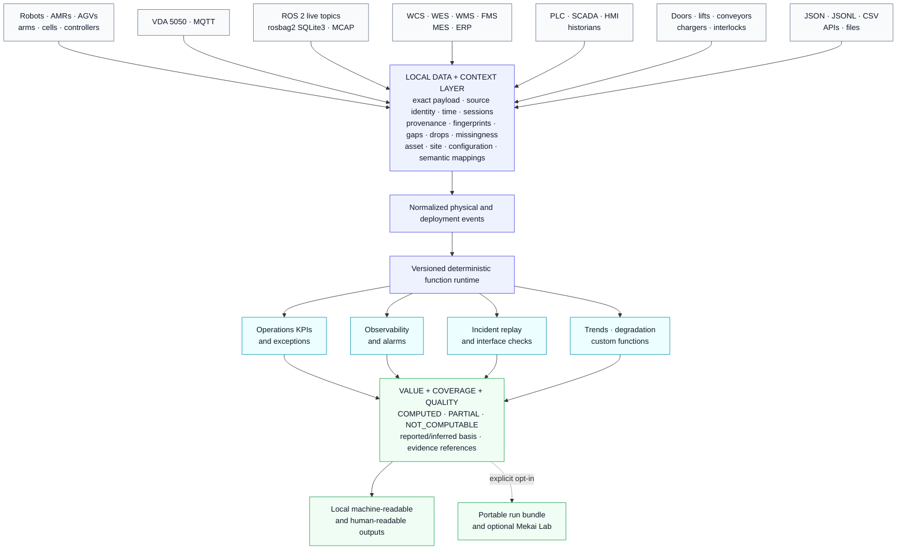
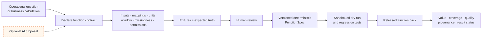
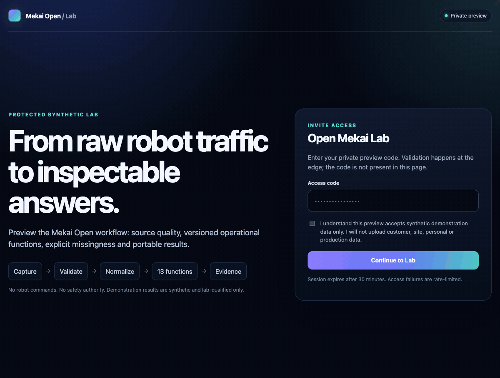

<div align="center">

<picture>
  <source media="(prefers-color-scheme: dark)" srcset="./docs/assets/mekai-mark-light.svg">
  <source media="(prefers-color-scheme: light)" srcset="./docs/assets/mekai-mark-dark.svg">
  
</picture>

# Mekai Open

### The open data and function layer for physical automation.

Turn deployment data into versioned, inspectable functions that return the value, coverage, quality, missingness and provenance behind every result.

[](https://github.com/Mekai-Labs/mekai-open/actions/workflows/ci.yml)
[](https://www.python.org/)
[](https://github.com/VDA5050/VDA5050)
[](LICENSE)

[Mekai Labs](https://mekailabs.com) · [Open Lab](https://open.mekailabs.com) · [Security](SECURITY.md) · [Contribute](CONTRIBUTING.md)

**Local-first · read-only · vendor-neutral by design · nothing sent by default**

</div>

---

## One layer for automation data and functions

Robot and factory data already exists in controllers, brokers, bags, fleet systems, PLCs, SCADA, historians and files. Mekai Open is being built to preserve where that data came from, what happened to it, and which conclusions it can support—then let anyone add reusable functions on top.

It does not replace a robot, fleet manager, WCS, PLC or dashboard. It makes their data usable through one inspectable foundation.

This is the open foundation of [Mekai Labs](https://mekailabs.com): intelligence infrastructure for deployed physical automation. The broader Mekai Platform applies the same evidence discipline to commissioning, acceptance, change and revalidation; Mekai Open keeps the shared data and function layer transparent and independently useful.

### Target architecture — availability is shown below



The intended result is not another opaque dashboard. It is a portable calculation layer where every answer carries enough evidence to reproduce, dispute or refuse it.

## How custom functions will be created

**Target lifecycle — planned, not part of the current public interface.** AI may draft mappings, calculations and tests; it does not approve semantics or produce authoritative conclusions.



The runtime boundary is designed around declared inputs and outputs—not arbitrary `eval`, unreviewed plug-ins or AI-generated execution.

## Open function-pack direction

The project grows one market-proven function family at a time on the same data and context layer.

| Order | Open function family | What it opens |
|---:|---|---|
| 1 | Operations KPIs and exceptions | Availability, durations, orders, throughput signals and explicit missingness |
| 2 | Live observability | Multi-source robot and site-system state |
| 3 | Alarms | Definition, evaluation, suppression and routing |
| 4 | Incident replay and evidence | Reconstruct what was observed without inventing missing facts |
| 5 | Interface verification | Robot-to-door, conveyor, lift, charger and PLC handshakes |
| 6 | Trends and degradation | Compare observed behavior against declared references |
| 7 | Custom function builder | Create reviewed, versioned functions on the shared layer |
| 8 | Robotic arms and automation cells | Extend the same contracts beyond mobile robots |
| 9 | Site equipment | Functions for connected physical infrastructure |
| 10 | FMS | Evaluate later; not currently planned |

### Open project and commercial platform

| Mekai Open | Commercial Mekai Platform |
|---|---|
| Data, context and provenance | Commissioning workflows |
| Versioned function runtime and open packs | FAT, SAT and UAT execution |
| Coverage, missingness and replay primitives | Acceptance, approvals and governance |
| Portable local results | Accepted baselines and change impact |
| Open operational calculations | Revalidation and controlled closeout |

The open runtime must remain useful on its own. The commercial product can build deployment and acceptance workflows on top without hiding the underlying calculation semantics.

## Live synthetic Lab

[open.mekailabs.com](https://open.mekailabs.com) is a protected preview of how portable results can be reviewed. The sequence below is captured from the live site; it uses synthetic demonstration data and does not expose an access code.



The current Lab accepts only the approved synthetic fixture. The final encrypted `.mekai-run` contract and public exporter are not part of this repository release.

---

## What this repository can do today

The current code is the calculation core of the first function pack: recorded VDA 5050 3.0.0 operations analysis, synthetic/lab-qualified.

```mermaid
flowchart LR
    A["Mekai Capture JSONL"] --> B["Bounded streaming<br/>input boundary"]
    B --> C["VDA 5050 3.0.0<br/>structural validation"]
    C --> D["Normalized observations<br/>+ exact provenance"]
    D --> E["13 registered<br/>versioned functions"]
    E --> F["Coverage · quality<br/>diagnostics · missingness"]
    F --> G["Deterministic<br/>analysis-run model"]

    classDef input fill:#eef2ff,stroke:#4f46e5,color:#111827;
    classDef core fill:#ecfeff,stroke:#0891b2,color:#111827;
    classDef result fill:#f0fdf4,stroke:#16a34a,color:#111827;
    class A input;
    class B,C,D,E core;
    class F,G result;
```



| Executable capability | Current boundary |
|---|---|
| Strict Capture JSONL ingestion | Bounded streaming parser, exact payload bytes, canonical encoding, source identity, sessions and drops |
| VDA 5050 3.0.0 structural validation | `connection`, `state`, `order` and `instantActions` against pinned vendored schemas |
| Recorded analysis core | One normalized pass through 13 registered executors into a deterministic run document |
| Source health and provenance | Fingerprints, coverage, gaps, missingness, clock/header diagnostics and retained evidence references |
| Function contracts | Versioned IDs, declared fields, basis, missing-data rules, fixtures and result schemas |
| Result discipline | Explicit `COMPUTED`, `PARTIAL` and `NOT_COMPUTABLE`; reported and inferred results stay separate |
| Public CLI | List and inspect the built-in function specifications |
| Qualification | Synthetic truth fixtures and adversarial tests on Python 3.12 |

### First function pack: 13 functions

| Source and availability | Reported robot state | Orders and incidents |
|---|---|---|
| State-stream health | Connection-state duration | Observed orders |
| Drops, gaps and sessions | Driving duration | Inferred error episodes |
| Clock and header diagnostics | Operating-mode duration | Inferred protocol order outcomes |
| Coverage and missingness | Paused duration | Inferred execution duration |
|  | Charging duration | Inferred finished orders per observed robot-hour |
|  | Battery state-of-charge summary |  |
|  | Reported safety-state duration |  |

Every function has a versioned contract. A result never silently fills missing time, treats a schema-valid message as behavioral conformance, or calls an inferred protocol outcome a business outcome.

### Current release boundary

The stable end-user `analyze` command, live MQTT collection, ROS 2 bag adapters and encrypted `.mekai-run` exporter are **not in the current public release**. Their names are not presented as executable commands until clean-install qualification passes.

## Quickstart

Requires Python 3.12.

```bash
git clone https://github.com/Mekai-Labs/mekai-open.git
cd mekai-open
python3.12 -m venv .venv
source .venv/bin/activate
python -m pip install --require-hashes -r requirements-runtime.txt
python -m pip install --no-deps -e .
mekai-open specs list
mekai-open specs describe vda.state_stream_health@0.1.0
```

The analysis engine is currently a package-internal boundary. The CLI deliberately exposes only interfaces that are ready for clean-install use.

## Trust and safety boundary

- **Read-only:** Mekai Open does not command robots or site equipment.
- **Not a safety authority:** reported safety fields are descriptive telemetry, not a safety or conformity finding.
- **Not certification:** structural schema validity is not behavioral conformance, certification or acceptance.
- **No hidden certainty:** reported and inferred results remain visibly different; missing data is part of the result.
- **No production claim:** current qualification is synthetic/lab-only; universal cross-vendor or production qualification is not claimed.
- **Local by default:** nothing is uploaded unless the user explicitly chooses an external viewer flow.

## Contributing, security and license

Read [CONTRIBUTING.md](CONTRIBUTING.md) before opening a pull request. Report vulnerabilities privately through [SECURITY.md](SECURITY.md).

Copyright © 2026 Kaustubh Krishna and Mekai Open contributors.

Licensed under **AGPL-3.0-only**. See [LICENSE](LICENSE), [NOTICE](NOTICE) and [THIRD_PARTY_NOTICES.md](THIRD_PARTY_NOTICES.md).
